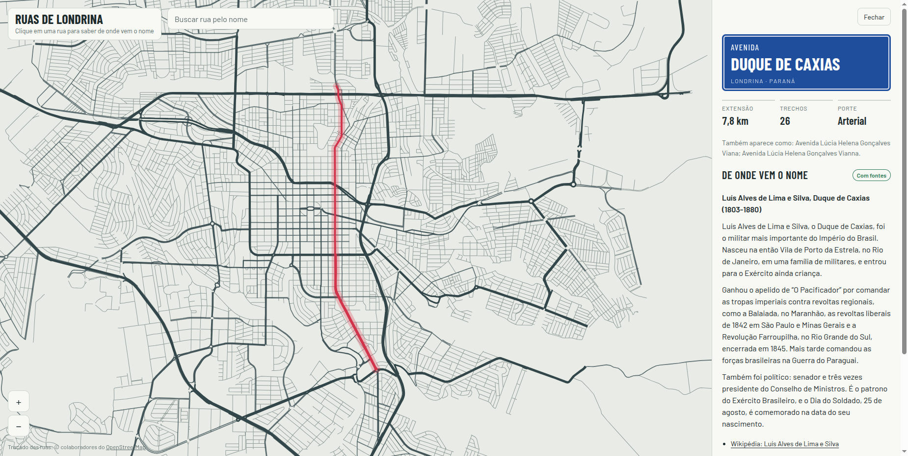

# Ruas de Londrina

Mapa das ruas de Londrina (PR). Clique em uma rua para saber de onde vem o nome dela.



## Como contribuir com um verbete

1. Abra o site, clique na rua e use o botão **Escrever este verbete**. Ele abre o GitHub com o arquivo já nomeado e um modelo preenchido.
2. Escreva o texto, informe as fontes e envie o pull request.
3. A conferência automática verifica o formato. Depois disso, alguém revisa e aprova.

Para corrigir um verbete que já existe, use o botão **Sugerir correção** no painel da rua.

### Formato

Cada verbete é um arquivo `verbetes/<nome-da-rua>.json`. O nome do arquivo é o nome da rua em minúsculas, sem acentos e com hífens, por exemplo `avenida-duque-de-caxias.json`.

```json
{
  "rua": "Avenida Duque de Caxias",
  "homenageado": "Luís Alves de Lima e Silva, Duque de Caxias (1803–1880)",
  "confirmado": true,
  "texto": ["Primeiro parágrafo.", "Segundo parágrafo."],
  "fontes": [{ "titulo": "Nome da fonte", "url": "https://..." }]
}
```

- `rua`: exatamente como aparece no mapa.
- `homenageado`: nome completo e datas. Pode ficar vazio se o nome não for de uma pessoa.
- `confirmado`: use `false` quando a origem do nome ainda for uma hipótese. O site mostra o aviso "Origem não confirmada".
- `texto`: dois ou três parágrafos curtos, com suas próprias palavras.
- `fontes`: pelo menos uma. Para homenageados locais, a melhor fonte é a lei municipal que deu o nome à rua.

Para conferir antes de enviar: `python scripts/validar.py`.

### Progresso no mapa

As ruas que já têm verbete aparecem em verde no mapa, e o quadro no canto mostra quantas ruas da área visível já foram escritas. Aproxime o mapa do seu bairro para ver o que falta por lá.

A lista dessas ruas fica em `data/verbetes.json`, gerada por `python scripts/indice.py`. Você não precisa mexer nela no pull request: quando um verbete entra na `main`, a ação `.github/workflows/indice.yml` atualiza o arquivo.

## Rodar no seu computador

```
python -m http.server 8000
```

Depois abra `http://localhost:8000`. Abrir o `index.html` direto do disco não funciona, porque o navegador bloqueia a leitura dos arquivos JSON.


## Dados

O traçado das ruas vem do OpenStreetMap, © colaboradores do OpenStreetMap, sob a licença ODbL. O arquivo `data/ruas.json` é uma versão compactada de uma exportação feita em 14/11/2026.
